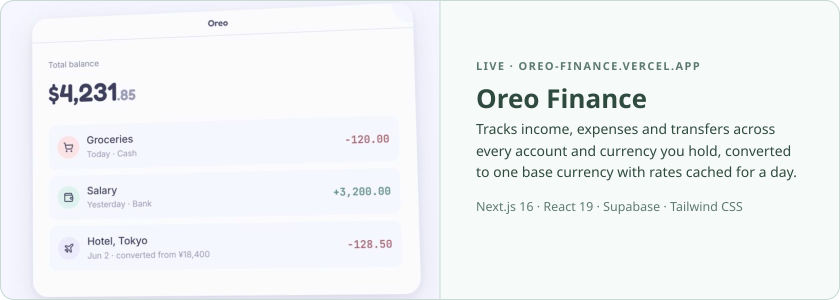
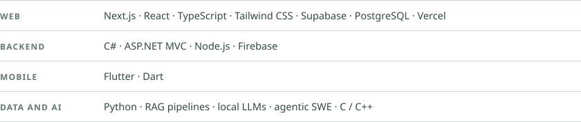

<!-- Visuals live in assets/ and are generated by scripts/build_assets.py; edit the script, not the SVGs. -->

<picture>
  <source media="(prefers-color-scheme: dark)" srcset="assets/hero-dark.svg">
  
</picture>

  
  

### About

I'm a senior Computer Science student at Visayas State University and a DOST scholar. I build web apps that turn paper-and-logbook workflows into reliable software.

- **Freelance web developer.** I build full-stack apps for clients, from schema to deploy.
- **Backend developer at [Veris](https://github.com/Atlas-VSU/veris-system-firebase).** Veris is a workflow platform used by VSU course organizations and the student council.
- **Peer in the GCI World September 2026 cohort.**
- **Currently studying** agentic software engineering, RAG pipelines, local model analysis, and data analytics with Python.

### Featured work

<a href="https://github.com/jamir4270/oreo-finance"><picture>
  <source media="(prefers-color-scheme: dark)" srcset="assets/card-oreo-dark.svg">
  
</picture></a>

<a href="https://github.com/BSN101/project-florence"><picture><source media="(prefers-color-scheme: dark)" srcset="assets/card-florence-dark.svg"></picture></a><a href="https://github.com/CSci-153-Web-Systems-and-Technologies/batch-2025-vsu-ncs-web"><picture><source media="(prefers-color-scheme: dark)" srcset="assets/card-ncs-dark.svg"></picture></a>

### Stack

<picture>
  <source media="(prefers-color-scheme: dark)" srcset="assets/stack-dark.svg">
  
</picture>

<picture>
  <source media="(prefers-color-scheme: dark)" srcset="assets/wave-dark.svg">
  
</picture>

Like what I build? <a href="https://ko-fi.com/jamir4270">Buy me a coffee on Ko-fi</a>.
